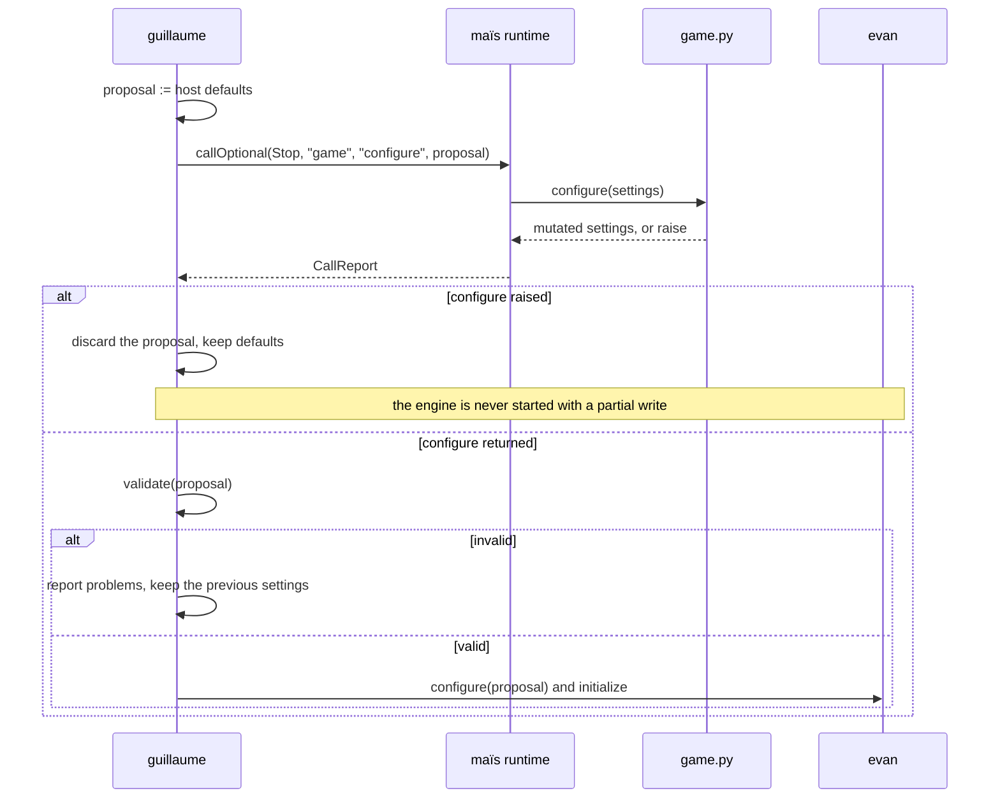
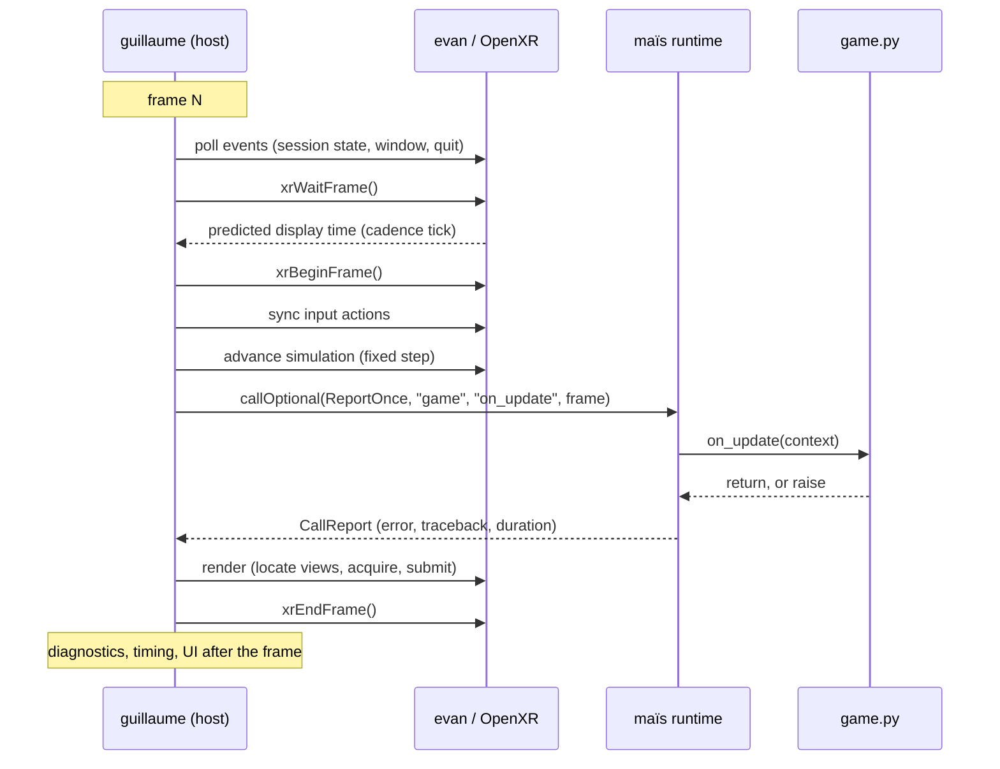

# Host integration: the adapter pattern and the hook schedule

**Status:** M2, MAIS-2.2 (#10); records roadmap ADAPTER-2.1, ADAPTER-2.2 and
HOST-2.3.
**Applies to:** `guillaume`, the optional `evan-scripting` adapter, and any
other host that embeds maïs.

[ARCHITECTURE.md](ARCHITECTURE.md) states the rules: the adapter owns the
binding definitions, the host owns the loop, and each consumer specifies where
its script hooks sit relative to engine update and render. This document is the
recipe those rules imply — what to build, in which project, in which order, and
why the order is not arbitrary.

Everything described here is implemented in `guillaume` or in an
`evan-scripting` adapter. None of it adds engine, renderer, or UI code to maïs.
[GETTING_STARTED.md](GETTING_STARTED.md) covers the general host tutorial;
[THREADING.md](THREADING.md) is the thread and GIL contract this document
assumes.

## What goes where

| Concern | maïs | `evan-scripting` adapter | `guillaume` (host) |
| --- | --- | --- | --- |
| Interpreter lifecycle | owns it | calls nothing directly | calls `initialize()` / `shutdown()` |
| Binding definitions | provides the registry | **declares** the narrow facade | decides which modules to queue |
| pybind11 | private to `sources/` | used in its own `.cpp` | not needed: the adapter writes every binding |
| Engine objects | unaware of them | translate, never own | own and configure |
| Settings validation | unaware of it | may expose the schema | decides and applies |
| Startup order | no opinion | no opinion | `configure`, validate, then initialize the engine |
| Frame loop and pacing | no opinion | no opinion | owns both |
| When hooks run | runs one when asked | no opinion | chooses every call site |
| Engine configuration semantics | never interprets | translates a subset | resolves conflicts and defaults |

The engine and scheduling rows are the ones a consumer gets wrong first. maïs
executes a script function at the moment the host asks; it has no notion of a
frame, a session, or an engine, and it must not acquire one.

### Must not be implemented in maïs

| Item | Why it stays out | Where it belongs |
| --- | --- | --- |
| Engine session, renderer, windowing, frame pacing | maïs must build and pass its tests with no engine present | `evan` |
| An `IEngine` abstraction | one consumer is not evidence of a common contract; it would put engine concepts in the library's public API | nowhere today; a second real integration may reopen it |
| A Python-side `Engine()` constructor | Python would create a second engine or re-run a lifecycle the host already owns | not exposed at all |
| Interpretation of script-proposed settings | validation is consumer policy, not a scripting service | adapter plus host |
| UI: script console, settings panel, viewport | maïs reports diagnostics; presenting them is the application's job | `guillaume` UI |
| The application main loop, or calling hooks on the host's behalf | the host owns scheduling and pacing | `guillaume` |

`./scripts/check-boundaries.sh` enforces the compile-time half of this table;
the rest is enforced by review against this document.

## Writing the adapter

The adapter's whole job is a narrow, stable, Python-visible surface over
host-owned native state. It defines bindings and converters; it does not run,
schedule, or own anything.

### Rules

1. **Bind a facade, not the engine.** A facade is a struct of values the host
   already owns plus a small number of commands. If a script needs a value from
   `evan`, the host copies that value into the facade each frame; the script
   never receives an engine handle.
2. **The adapter keeps pybind11 out of the host.** Its public header includes
   only `mais/ScriptRuntime.hpp`. The host links `pybind11::embed` because the
   final executable embeds Python, but it includes no pybind11 header.
3. **Registration happens before the interpreter starts.** The adapter exposes
   a `register...Bindings(runtime, services)` function that the host calls once,
   before `initialize()`. The runtime runs every queued callback while Python
   starts, so a later call fails with `AlreadyInitialized`, and a script that
   imports a missing module sees an ordinary `ModuleNotFound`.
4. **A command is a request, not an action.** `request_quit()` sets a flag the
   host reads; it does not stop the engine, end the session, or call
   `shutdown()`. This keeps every lifecycle decision, and its ordering against
   the frame loop, in one place.
5. **Everything the bindings reach is owned by the host** and outlives the
   runtime. The adapter stores references; it never copies engine state into
   Python-owned objects that could outlive it.

### The two argument forms

maïs offers two ways for a script to see host state, and they are not
interchangeable.

| Form | Shape | Use for | Availability |
| --- | --- | --- | --- |
| `import evan` module | `evan.settings`, `evan.request_quit()` | services and commands a script reaches for by name, independent of the hook | every 1.x |
| Object argument | `configure(settings)`, `on_update(context)` | the per-hook facade: one object, passed to that hook, with no import | `ScriptArgument::native()`, MAIS-1.1 (#1); implemented on `main`, released in 1.1.0 |

The object-argument form is the better default for frames: it makes the
dependency explicit in the function signature, it lets the host pass a
different object per call, and it costs nothing when the hook is absent. The
module form stays useful for commands and for a consumer pinned to 1.0.0. A
project pinned to 1.0.0 uses the module form for both and reads the per-frame
values from an attribute the host rewrites, as
`examples/standalone_host` does.

Both forms obey the same lifetime rule: the Python wrapper borrows a native
object the host owns. The object must outlive `mais::ScriptRuntime::shutdown()`.

### Worked example

The example below is the `evan-scripting` adapter, as a consumer would write it.
It uses only the maïs API on `main`; nothing it depends on is pending. The
placeholders are the host's own: `loadHostDefaults()`, `validate()`, `console`,
and the `evan` engine calls an adapter would wrap.

```text
guillaume/
  scripts/                  game.py — host-owned, not shipped by maïs
  src/
    main.cpp                host: loop, ordering, validation
    scripting/
      EvanScripting.hpp     narrow facade and registration entry point
      EvanScripting.cpp     pybind11 bindings and converters
```

#### The adapter header

```cpp
// guillaume/src/scripting/EvanScripting.hpp
#pragma once

#include "mais/ScriptRuntime.hpp"

#include <cstdint>
#include <string>

namespace guillaume::scripting
{
	/// The subset of evan's startup configuration a script may propose.
	struct SettingsProposal {
		std::string windowTitle;
		double renderScale = 1.0;
		std::uint32_t msaaSampleCount = 1;
	};

	/// The per-frame values a hook may read. The host rewrites these fields
	/// before each call; a script reads them and cannot write them.
	struct FrameContext {
		std::uint64_t index = 0;
		double stepSeconds = 0.0;
		double elapsedSeconds = 0.0;
		bool sessionFocused = true;
	};

	/// Everything the bindings reach. Owned by the host, outlives the runtime.
	struct Services {
		SettingsProposal hostDefaults;
		SettingsProposal proposal;
		FrameContext frame;
		bool quitRequested = false;
	};

	/// Queues the `evan` module. Call once, before ScriptRuntime::initialize().
	mais::Error registerEvanBindings(mais::ScriptRuntime &runtime,
									 Services &services);

	/// Arguments for the two hooks that receive an object.
	mais::ScriptArgument settingsArgument(SettingsProposal &proposal);
	mais::ScriptArgument frameArgument(FrameContext &context);
}
```

No pybind11 include, no engine type, no `evan` header: the host can include
this file without learning either dependency.

#### The adapter implementation

```cpp
// guillaume/src/scripting/EvanScripting.cpp
#include "EvanScripting.hpp"

#include <pybind11/embed.h>

namespace py = pybind11;

namespace guillaume::scripting
{
	namespace
	{
		/// maïs takes ownership of exactly one reference to the object the
		/// converter returns, so the py::object that wraps the borrowed native
		/// address is released instead of being destroyed at the end of the
		/// lambda. The native object itself is never copied or owned.
		template<typename T> void *borrowedReference(const void *value)
		{
			return py::cast(static_cast<const T *>(value),
							py::return_value_policy::reference)
				.release()
				.ptr();
		}
	}

	mais::ScriptArgument settingsArgument(SettingsProposal &proposal)
	{
		return mais::ScriptArgument::native(
			&proposal, &borrowedReference<SettingsProposal>);
	}

	mais::ScriptArgument frameArgument(FrameContext &context)
	{
		return mais::ScriptArgument::native(
			&context, &borrowedReference<FrameContext>);
	}

	mais::Error registerEvanBindings(mais::ScriptRuntime &runtime,
									 Services &services)
	{
		return runtime.registerModule(
			"evan", [&services](mais::PythonModule &module) {
				py::module_ &evan = module.as<py::module_>();

				// The class must exist before a hook can receive an instance:
				// an unregistered class makes the call fail with TypeMismatch
				// instead of passing an unusable object to the script.
				py::class_<SettingsProposal>(evan, "SettingsProposal")
					.def_readwrite("window_title",
								   &SettingsProposal::windowTitle)
					.def_readwrite("render_scale",
								   &SettingsProposal::renderScale)
					.def_readwrite("msaa_sample_count",
								   &SettingsProposal::msaaSampleCount);

				py::class_<FrameContext>(evan, "FrameContext")
					.def_readonly("index", &FrameContext::index)
					.def_readonly("step_seconds", &FrameContext::stepSeconds)
					.def_readonly("elapsed_seconds",
								  &FrameContext::elapsedSeconds)
					.def_readonly("session_focused",
								  &FrameContext::sessionFocused);

				// A request the host acts on at a point it controls, not a
				// lifecycle call the script performs.
				evan.def("request_quit",
						 [&services]() { services.quitRequested = true; });
			});
	}
}
```

The `def` and `attr` lambdas outlive `registerEvanBindings()`: they stay
callable for as long as Python can reach the module. Capturing `services` by
reference is therefore correct only because the host declares it before the
runtime and destroys it after `shutdown()` — the same rule the converter relies
on.

#### The host's side

```cpp
// guillaume/src/main.cpp, startup excerpt
guillaume::scripting::Services scripting;
scripting.hostDefaults = loadHostDefaults();
scripting.proposal = scripting.hostDefaults;

mais::ScriptRuntime runtime;

if (mais::Error error =
		guillaume::scripting::registerEvanBindings(runtime, scripting);
	error) {
	return reportAndFail("registerEvanBindings", error);
}
if (mais::Error error = runtime.initialize(); error) {
	return reportAndFail("initialize", error);
}
if (mais::Error error = runtime.addSearchPath(scriptDirectory); error) {
	runtime.shutdown();
	return reportAndFail("addSearchPath", error);
}
if (mais::Error error = runtime.loadModule("game"); error) {
	runtime.shutdown();
	return reportAndFail("loadModule", error);
}
```

`scripting` is declared before `runtime`, so it is still alive when the runtime
is destroyed — including on the early-return paths above, where the destructor
is what finalizes Python. Declare it after the runtime and an early return tears
the facade down while Python may still hold a wrapper pointing at it.

#### The script's side

```python
import evan


def configure(settings):
    settings.window_title = "Guillaume"
    settings.render_scale = 1.25
    settings.msaa_sample_count = 4


def on_start(context):
    print("game: started, focus is", context.session_focused)


def on_update(context):
    # `context` is the host's object, rewritten before this call. Reading it
    # sees this frame's state; there is no way to write it back.
    if context.elapsed_seconds > 600.0:
        evan.request_quit()


def on_shutdown(context):
    print("game: stopped after", context.index, "frames")
```

### What must never cross the boundary

| Tempting addition | What breaks | Where it belongs instead |
| --- | --- | --- |
| Binding `evan::Engine &` | every engine method becomes part of the script API, and every engine change becomes a script compatibility problem | a facade struct with the fields and commands a script actually needs |
| `xrSession`, `xrSwapchain`, `VkDevice`, image handles | their validity is per-frame and bound to the same protocol the host is driving; a script can desynchronize the frame pair | the adapter, as values copied out of engine state |
| A Python `Engine()` constructor | the host already owns one engine; a second one silently violates single-owner semantics, and neither lifetime is expressible in Python | not exposed |
| `mais::ScriptRuntime` inside the module | a script could shut the interpreter down under the host, or restart it mid-frame | host only |
| `shutdown()`, `initialize()`, `loadModule()` reached from a hook | they are thread-affine and lifecycle-ordered; a hook runs inside that lifecycle | host, between phases |
| Any blocking call in a hook (`sleep`, network, waiting on a future) | it spends the frame budget, and the owner is the only thread that runs Python, so the host loop cannot move on | host background work, polled from a hook |
| The frame loop, inside the adapter | the adapter cannot pace a render it does not own | host |

If a script seems to need one of these, the facade is missing a value or a
command. Add that, not the object.

## Validate, then apply

Configuration is a proposal, not a command. The host owns the defaults, the
validation rules, and the moment the engine reads them, so a script can never
put the engine into a state the host cannot describe.



```cpp
// Still before the engine exists.
mais::CallReport configured = runtime.callOptional(
	mais::FailurePolicy::Stop, "game", "configure",
	{guillaume::scripting::settingsArgument(scripting.proposal)});

if (configured) {
	console.log(configured.error.toString());   // message plus traceback
}
if (configured.stopRequested) {
	// Stop is the right policy here: a hook that raised may have written only
	// part of the facade, so "the proposal" is not a coherent set of values.
	runtime.shutdown();
	return 1;
}

const std::vector<std::string> problems = validate(scripting.proposal);
if (!problems.empty()) {
	console.log("rejected settings proposal: " + join(problems));
	scripting.proposal = scripting.hostDefaults;  // previous settings win
}

if (auto error = engine.start(scripting.proposal.toEngineConfig()); error) {
	// The engine refused its own configuration. That is an engine failure, not
	// a script failure: it is reported, and startup stops.
	return reportAndFail("engine start", error);
}
```

| What happened | Runtime reports | Host does |
| --- | --- | --- |
| `configure` does not exist | success (`callOptional`) | start with host defaults |
| `configure` returns without writing | success | validate the defaults; nothing changed |
| `configure` writes an invalid value | success — writing a field is not a Python error | reject, report each problem, keep the previous settings |
| `configure` raises | `CallReport` with the error, its traceback, and `stopRequested` | do not start the engine; do not apply a partially written proposal |
| Python is stopped or the call comes from another thread | `NotInitialized` / `WrongThread`, `stopRequested` still set under `Stop` | treat as a failed configure |

Validation runs on the host, after the call has returned and before the engine
reads anything. No Python code runs during validation, so nothing can change the
proposal between the check and the apply — as long as the host does not hand the
same object to another hook in between.

Two consequences worth stating:

- **The proposal is a copy, not the live engine configuration.** If validation
  rejects it, the engine's previous settings are still intact; there is nothing
  to roll back.
- **There is no runtime reconfiguration in this contract.** Applying settings
  after `initialize()` needs its own design, thread rules, and error path
  (`evan`'s problem, not maïs's). Keep every script-writable setting in the
  startup proposal until that exists.

`on_start` uses the same shape with `FailurePolicy::Stop`: a session whose start
hook failed should not enter its loop. `on_shutdown` uses `Continue`, so a
failing shutdown hook can never prevent the host from stopping the engine.

## The hook schedule

maïs does not define when hooks run; the host calls them. A frame-driven XR host
therefore has to answer three questions explicitly, in this order:

1. which hooks exist,
2. where each one sits relative to input, simulation, and render,
3. what the frame-pacing budget allows the hook to do.

### The hooks

Names are host-defined. These are the four `guillaume` uses; maïs would accept
any other name in any loaded module.

| Hook | Fires | Argument | Policy | Host must |
| --- | --- | --- | --- | --- |
| `configure` | after `loadModule`, before the engine exists | `SettingsProposal` (writable) | `Stop` | validate, then apply or reject |
| `on_start` | after the engine is initialized, before the first wait-frame | `FrameContext` | `Stop` | tear the session down without entering the loop |
| `on_update` | once per frame, inside the budget window | `FrameContext` | `ReportOnce` | render afterwards regardless of the outcome |
| `on_shutdown` | after the loop exits, before the engine stops | `FrameContext`, final values | `Continue` | always attempt it, then stop the engine |

`on_pause`, `on_resume`, and similar hooks are host-defined additions. Rule
them from session-state events in step 1 below, give them `Continue`, and
remember that pausing must not call `shutdown()`: restarting the interpreter is
not a per-event operation.

### The frame

This is the ordering `guillaume` adopts (roadmap HOST-2.3), written out for a
90 Hz OpenXR session. Every step runs on the thread that called
`initialize()`; maïs has no other supported mode.

| # | Loop point | Owner | What runs | Why exactly here | Constraint it must respect |
| --- | --- | --- | --- | --- | --- |
| 1 | Poll events | host | `xrPollEvent`, window and input events, quit and pause requests | a session that is stopping, or a user who asked to quit, must be known before the host decides to consume a frame | no script code; drains the queue without waiting |
| 2 | Wait for cadence | engine | `xrWaitFrame` | blocks until the compositor's cadence tick and returns the predicted display time everything below is computed from | the CPU budget starts when this returns: do not queue long work between the previous end-frame and this call |
| 3 | Begin frame | engine | `xrBeginFrame` | opens the frame that step 8 closes | exactly one pair per frame |
| 4 | Sample input | engine | `xrSyncActions` and space locations at the predicted display time | the script must see this frame's input, not the previous frame's | completes before step 6 |
| 5 | Advance simulation | engine | one fixed step, `dt = 1 / 90` | engine state is current before the script observes it | fixed step; catch-up steps bounded |
| 6 | Call `on_update(context)` | maïs, called by the host | one `callOptional(FailurePolicy::ReportOnce, ...)` | last point where the script can still change what this frame renders, first point where this frame's input and simulation state both exist | one call per frame, inside the budget |
| 7 | Render | engine | locate views, acquire swapchain images, encode and submit | must see the script's writes, so it comes after step 6 | runs even when step 6 failed |
| 8 | End frame | engine | `xrEndFrame` | closes the frame pair opened in step 3 | never skipped, never conditional |

Two placements are wrong and worth naming:

| Placement | What it costs |
| --- | --- |
| `on_update` before step 5 | the script reads last frame's state, so it reacts one frame late to everything it observes; what it writes is consumed by this frame's simulation, so writes are a frame early |
| `on_update` after step 7 | what it writes is invisible until the next frame: writes are a frame late and the reads gain nothing |

The chosen placement trades one frame of *write* latency for exact *read*
latency. For a script that reacts to state and draws overlays, that is the
better half of the trade: it never acts on stale data, and what it changes is
on screen in the same frame.

### Frame pacing

The budget is the interval between step 2 returning and step 8 being called. It
covers the host's input handling, the engine's simulation and render submission,
and the script hook together.

| Refresh rate | Frame interval | Suggested `on_update` share |
| --- | --- | --- |
| 72 Hz | 13.9 ms | ≤ 2 ms |
| 90 Hz | 11.1 ms | ≤ 2 ms |
| 120 Hz | 8.3 ms | ≤ 1 ms |

The shares are host policy, not a maïs limit: they leave the rest of the
interval to input, simulation, and render submission.

The constraints that follow:

- **Nothing in a hook may block.** The interpreter is thread-affine and the GIL
  stays with that thread, so a hook that sleeps spends the budget and stops the
  host loop from moving on; a script-owned thread is not an escape hatch, since
  it only progresses while the owner is running Python. Waiting is the host's
  job, outside the window.
- **Pass the fixed step, not the wall-clock delta.** A hook that scales its work
  by the frame's actual duration makes script behaviour depend on how much
  headroom the host happened to have. Pass `1 / 90` every frame.
- **Cap catch-up.** If the loop falls behind, run at most a small number of
  steps and never call `on_update` more than once per rendered frame. A script
  called twice in one frame would apply its effect twice.
- **Measure, then degrade.** `CallReport::duration` is the runtime's own
  measurement of the call, in nanoseconds, including argument conversion and
  error capture. Chart it per hook; if a hook exceeds its share, reduce its
  cadence (every *N* frames) rather than skipping render, and give it the
  accumulated step so the script's own math stays consistent.
- **A failing hook never costs a frame.** `ReportOnce` reports the first failure
  of a streak with its traceback and suppresses identical repeats;
  `Continue` reports every failure. Neither stops the interpreter, and neither
  may be turned into "skip render".
- **Keep diagnostics off the pacing path.** Console output, file I/O, and UI
  updates belong after step 8, where they delay the next wait-frame instead of
  this frame's submission.
- **Pause means "stop calling hooks", not "stop the runtime".** Leave the
  interpreter running across a session pause; `shutdown()` is a session-scope
  operation.

### One frame



The startup and shutdown halves of the lifecycle are in
[ARCHITECTURE.md](ARCHITECTURE.md); this diagram is the steady state, repeated
for every frame the host decides to run.

### The loop, in code

```cpp
std::uint64_t executedFrames = 0;

for (std::uint64_t index = 0; !scripting.quitRequested; ++index) {
	pollEvents(scripting);                      // 1
	if (scripting.quitRequested || sessionEnding) {
		break;
	}

	const xr::FrameState frameState = engine.waitFrame();   // 2
	engine.beginFrame(frameState);                          // 3
	engine.syncInput(frameState.predictedDisplayTime);      // 4
	engine.advanceSimulation(fixedStepSeconds);             // 5

	scripting.frame.index = index;
	scripting.frame.stepSeconds = fixedStepSeconds;
	scripting.frame.elapsedSeconds =
		static_cast<double>(index) * fixedStepSeconds;
	scripting.frame.sessionFocused = engine.sessionFocused();

	mais::CallReport report = runtime.callOptional(
		mais::FailurePolicy::ReportOnce, "game", "on_update",
		{guillaume::scripting::frameArgument(scripting.frame)});  // 6
	++executedFrames;

	if (report) {
		diagnostics.report("on_update", report.error);
	}
	if (report.stopRequested) {
		// ReportOnce never sets this; a hook promoted to Stop would.
		break;
	}
	diagnostics.timing("on_update", report.duration);

	engine.render(frameState);   // 7
	engine.endFrame(frameState); // 8

	diagnostics.pump();          // console output, after the frame
}

scripting.frame.index = executedFrames;
runtime.callOptional(mais::FailurePolicy::Continue, "game", "on_shutdown",
					 {guillaume::scripting::frameArgument(scripting.frame)});
engine.stop();
runtime.shutdown();
```

`report.stopRequested` under `ReportOnce` is never true, so the branch costs one
comparison per frame and documents the intent: only a hook the host promoted to
`Stop` can ask this loop to leave. See
[ERROR_HANDLING.md](ERROR_HANDLING.md) for the full policy semantics.

The order at the end is deliberate. The last hook runs, the engine stops, and
only then does `shutdown()` release the Python references: stopping the engine
is not destroying it, so the facade objects a script borrowed are still alive
when the interpreter is finalized, which is what the lifetime contract requires.

## Checklist for the implementer

- [ ] The adapter's public header includes `mais/ScriptRuntime.hpp` and no
      pybind11, no `evan`, and no engine header.
- [ ] `register...Bindings()` is called once, before `initialize()`, and its
      `mais::Error` is checked.
- [ ] Every class a hook receives is registered by the binding callback.
- [ ] Every object handed to Python is declared before the runtime and outlives
      `shutdown()`.
- [ ] Converters return a new reference (`release().ptr()`) and never take
      ownership of the native object.
- [ ] `configure` runs before the engine exists; its result is validated before
      it is applied; a raised hook discards the proposal.
- [ ] `on_update` is called once per frame, after simulation and before render.
- [ ] Render and end-frame happen even when the hook failed.
- [ ] Every hook call uses a deliberate `FailurePolicy` and logs
      `CallReport::duration`.
- [ ] All script calls happen on the thread that called `initialize()`.
- [ ] Nothing in the adapter or the host was pushed into maïs.

## What this contract does not cover yet

| Topic | Status |
| --- | --- |
| Hooks on a thread other than the interpreter's owner | Not supported. [THREADING.md](THREADING.md) explains why, and MAIS-4.1 (#16) is the dispatch queue that would change it — only if Q5 in [ROADMAP.md](ROADMAP.md) is answered. |
| Reloading a script inside a running session | Not available. Design in MAIS-3.1 (#12); reload and unload in MAIS-3.2 (#13); change detection in MAIS-3.3 (#14). Until then, editing a script needs a session restart. |
| Runtime reconfiguration after engine start | Engine-owned. Keep script-written settings in the startup proposal. |
| Script packaging and resolution order | MAIS-2.3 (#11); maïs only resolves paths the host adds. |
| A runnable frame-loop host | `examples/standalone_host` is runnable today and covers binding, invocation, policy, and shutdown. The frame-driven variant lands with #9; the excerpts above are the same structure. |

Nothing in the table is a maïs commitment; each row is a host-side workaround
until the linked issue is delivered.
