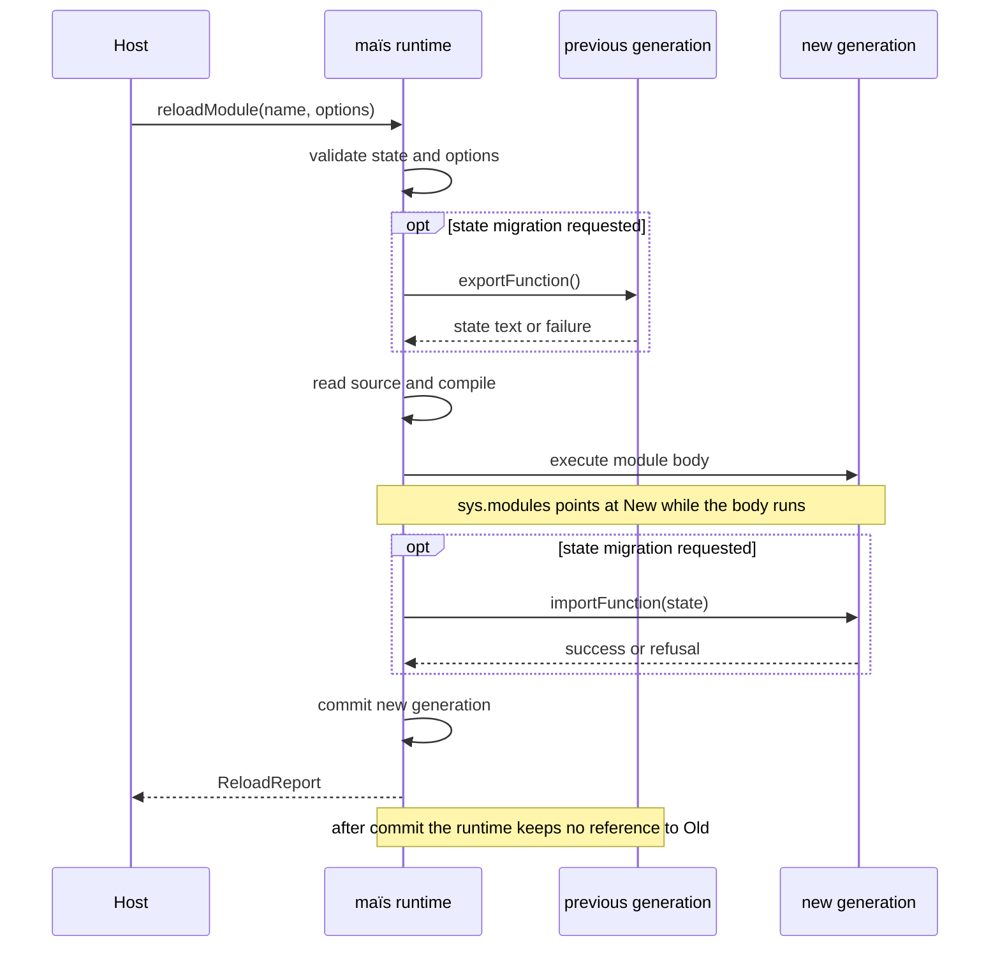

# Hot reload and state migration

**Status:** proposed for maintainer review (M3, MAIS-3.1). The questions below
are answered; the API additions in
[Proposed API](#proposed-api-for-approval) still need approval before MAIS-3.2
starts. Nothing in this document is implemented.

**Applies to:** `mais::ScriptRuntime`, and the frame contract a consumer
follows in [HOST_INTEGRATION.md](HOST_INTEGRATION.md).

This is the decision record behind M3. It exists because
[TECHNICAL_CHOICES.md](TECHNICAL_CHOICES.md) requires a deferred capability to
receive explicit requirements, tests, and ownership rules before it is
implemented, and because an unspecified reload is worse than none: it silently
loses state.

## The questions, and their answers

Iterating on an XR application currently means restarting the headset app, which
is the slowest feedback loop in the project. "Reload a script" has to mean
something precise enough to build and test, so the questions below are answered
here and elaborated in the linked sections.

| Question | Answer | Elaborated in |
| --- | --- | --- |
| What is re-executed, and what is left alone? | The module body. Its dependencies are reloaded only if the host reloads them explicitly, and bindings are never reloaded. | [What a reload executes](#what-a-reload-executes) |
| What happens to Python objects that still refer to the old code? | They remain valid, but they are stale. A reload produces a new module object, and the old one is released only after the new one commits. | [The previous generation after a reload](#the-previous-generation-after-a-reload) |
| How do native wrappers and host-owned objects stay valid? | The runtime never touches them. A wrapper that the old module returned still refers to the same host object after a reload, and the host must not destroy that object while a wrapper may still exist. | [Native bindings and host objects](#native-bindings-and-host-objects) |
| What state may cross the reload, who declares it, and what is refused? | If it can cross the reload, it is text. The host names two hooks, one to export state from the old generation and one to import it into the new generation. The script validates its own schema and raises to refuse; the runtime does not parse or mutate the payload. | [State migration](#state-migration) |
| What is the runtime state after a syntax error, a missing hook, or an exception during execution? | The previous generation is current and callable. The new generation is discarded, and the runtime restores `sys.modules` to point at the old module. | [Failure modes](#failure-modes) |
| What can the host observe, and what does a reload cost? | A `ReloadReport` carries the phase reached, the total duration, the compile, execute and state durations, the generation that is live when the call returns, and a recoverable `Error` with a traceback if the reload failed. | [Observability and cost](#observability-and-cost) |
| What happens when a reload does not fit an XR frame? | The runtime reports the duration; it does not enforce a budget and does not spread a reload across frames. The host decides whether to block, skip, or break the frame. | [Frame budget](#frame-budget) |
| Which API additions does this imply, and which are deliberately not made? | See [Proposed API](#proposed-api-for-approval) for the additions. The runtime does not watch files, does not reload on its own schedule, does not reload from a thread other than the one that called `initialize()`, and does not re-invoke hooks automatically. | [Proposed API for approval](#proposed-api-for-approval) |

Current behaviour is the starting point: `loadModule()` calls
`py::module_::import()`, which returns the cached `sys.modules` entry on a second
call. A host that calls `loadModule()` again gets the old code and no
notification. There is no `reloadModule()`, no `unloadModule()`, and no way to
release a module without stopping the interpreter. Commit `a7c79d0` is the
baseline for every statement below.

## The contract

The runtime will make the following guarantees. Everything else is explicitly
not promised, so a consumer cannot build on it by accident.

### Guaranteed

1. **Granularity is one module, whole-module, one at a time.** A reload
   re-executes the module body of one source-backed script module in a fresh
   namespace. It does not re-execute imported dependencies, and it does not
   reload bindings.
2. **A reload is transactional.** The new generation is executed and, when
   requested, restored before it becomes current. Any failure before the commit
   point leaves the previous generation current, unchanged, and still callable.
3. **Success is observable and costs a known number.** `reloadModule()` returns
   a `ReloadReport` with the phase reached, the total duration, the compile,
   execute and state durations, and the generation that is live when the call
   returns.
4. **Successful reload increments the generation.** The new module object
   carries `__mais_generation__` and so does every later generation. The value
   starts at 1 for a first load, increments on each successful reload, and
   starts again at 1 after unload and load.
5. **Bindings and host objects are untouched.** pybind11 types are registered
   once per interpreter, `registerModule()` is not re-run, and a native wrapper
   that Python still holds keeps referring to the same host object. The host
   object must outlive the runtime, exactly as it does today.
6. **Reload happens only where the host says.** maïs never watches files,
   never reloads on its own schedule, and never reloads from a thread other
   than the one that called `initialize()`.
7. **Detection is an explicit poll.** `pollModuleChanges()` reports changes to
   loaded, source-backed modules; the host chooses the cadence and the safe
   point at which it calls `reloadModule()`.
8. **State migration is opt-in, textual and script-validated.** Without
   options, state resets. With options, the runtime transports an opaque
   `std::string` between two host-named hooks; the script validates its own
   schema and raises to refuse.
9. **A failed reload does not stop the session.** The report carries a
   recoverable `Error` with a traceback where Python raised one. Reload never
   stops the interpreter and never throws for an expected failure.

### Not guaranteed

1. **Object identity across generations.** A reload produces a new module
   object. `new_module.Class` is not `old_module.Class`, and
   `isinstance(old_instance, new_module.Class)` is false. Old objects remain
   valid Python objects, but they are stale.
2. **Reference rewriting.** maïs does not walk other modules, host callbacks,
   generators, tracebacks, or containers to point them at the new generation.
   Code that captured the old generation keeps running old code.
3. **Dependency reload.** If `game.py` imports `helper.py`, reloading `game`
   does not reload `helper`, and a `from helper import value` binding stays
   old. A second `import helper` in the new body gets the cached module.
4. **Rollback of side effects.** A failed reload restores the runtime's view of
   the module. It cannot close a file the new module opened, undo a global
   mutation, or remove a `sys.modules` entry the new body imported.
5. **Frame-time guarantees.** A reload is synchronous and cannot be
   interrupted. The runtime reports its cost; it does not enforce a budget and
   does not spread a reload across frames.
6. **Arbitrary object migration.** Live objects, closures, generators,
   file/socket handles, threads, locks, native wrappers and module objects
   cannot cross a reload. Only text can.
7. **Reloading native code.** Bindings, pybind11 type registrations, and the
   runtime itself are interpreter-scoped. There is no C++ recompilation, no
   binding re-registration, and no add-on reload.
8. **Reload from inside a hook.** The reload point must be quiescent. Calling
   `reloadModule()` from a host binding that a hook invoked is unsupported;
   the runtime does not detect it.
9. **Automatic hook re-invocation.** The runtime does not know hook names. A
   reload does not call `configure`, `on_start`, `on_update`, or any other
   host-defined hook. The host decides, within its own lifecycle rules.
10. **Same-size, same-timestamp edits.** Detection compares the file's size and
    last-write time. An edit that preserves both within the filesystem's
    timestamp granularity is not detected.
11. **Cross-process reload and subinterpreters.** Neither is part of M3; see
    [What this design does not cover](#what-this-design-does-not-cover).

## Scope and granularity

**Decided:** reload is *whole-module generation replacement*, for one
source-backed module at a time.

- **Source-backed** means the module was loaded through `loadModule()` from a
  file whose source path the runtime recorded. A module created by
  `registerModule()` has no source and is not reloadable. A sourceless `.pyc`
  is not reloadable because reload compiles source text, not bytecode.
- **Generation replacement** means the new code executes in a new module object.
  The old module object is retained privately until the new generation commits,
  then released. Building the new generation in a fresh namespace is what makes
  stale-name retention and rollback tractable.
- **One module at a time** is the unit of atomicity and of reporting. A host
  that wants to reload several modules calls the operation once per module and
  reads one report per module.
- **Only modules the host loaded through `loadModule()` are in the set.** A
  dependency that a script imported on its own is neither watched nor
  reloadable until the host loads it explicitly. A host can reload modules in
  its own dependency order; maïs does not compute that order.
- **The same source file is re-executed.** Reload does not re-resolve the
  module name against `sys.path`. If a module moved, unload it and load it again
  from the new location. Re-resolution could silently switch to a different file
  that shadows the same name, which is the opposite of what a reload should do.
- **The runtime owns the `sys.modules` entry of each module it loaded.** A
  reload saves that entry and restores it on failure; script code that replaces
  or deletes it is unsupported. `unloadModule()` removes the entry only while it
  still points at the runtime's module object.

### Rejected granularities

| Alternative | Why it is not the design |
| --- | --- |
| **Per-hook replacement** (re-execute only the named function) | Module-level globals, imports, decorators and class identity make a function a fragment of its module. Replacing one function leaves the others reading the old globals, and two functions can disagree about the same class. There is also no sensible answer for module-level initialization. |
| **`importlib.reload()` in the existing module dictionary** | It re-executes in the same dict, so names removed from the file survive indefinitely, and old class objects stay reachable through the dict. It cannot roll back a failure: a partially executed body leaves a half-updated module. |
| **Clearing and re-executing the same module object** | Preserves module identity, but clearing the dict runs the old globals' finalizers in the middle of the swap, and every existing reference to the old module's functions is still an old function. Rollback would require a snapshot of a dict that other code may already have observed. |
| **Subinterpreter per script** | Each subinterpreter has its own module namespace and object graph, so every host binding and host object would have to be registered per interpreter. The pinned pybind11 2.13.6 creates single-phase modules with no multiple-interpreter slot; per-interpreter GIL only exists in CPython 3.12+, while the runtime supports 3.9–3.14; and the lifecycle contract is one interpreter per process. MAIS-4.5 stays conditional. |
| **Process swap** | Loses the XR session, the engine, and every host object the script can see. It is a restart with extra steps. |

## What a reload executes

A reload executes **the module body, from the beginning, in a new namespace**:

- the source is read from the path captured at load, as bytes, so a PEP 263
  encoding declaration is honoured;
- it is compiled with `compile(source, path, "exec", 0, dont_inherit=True)`,
  so a `from __future__` statement in the script applies and the runtime's own
  future flags do not leak in;
- the code runs with a new module object as globals, created from the previous
  module's spec so `__name__`, `__package__`, `__loader__` and the package
  search locations survive, with the captured source path written back to
  `__file__`;
- before the body runs, the runtime calls `importlib.invalidate_caches()` so
  imports performed by the new body see the current filesystem.

Re-executed: every top-level statement, `import`, decorator, class and function
definition, and assignment.

Not re-executed: imported dependency modules, host bindings, the runtime's own
`traceback` module, and any code in C++.

`loadModule()` keeps its current meaning: it imports the module if it is not
already loaded, records its source path and initial signature, and records
generation `1`. Calling it again on a loaded module returns the same module,
does not re-execute code, and does not reset the generation; re-execution is
`reloadModule()`.

`__mais_generation__` is an integer the runtime owns on every script module. It
is set after the module body succeeds: a first load sets `1`, each successful
reload increments it, and an unload followed by a load starts again at `1`.
Module-level code must not read it during execution; functions may read it at
call time. A script can stamp its objects with it at creation and compare later:

```python
class Entity:
    generation = __mais_generation__


def is_current(entity) -> bool:
    return entity.generation == __mais_generation__
```

That is the supported way to notice a stale object. The runtime does not
instrument classes or wrappers to raise on stale use.

## The operation, step by step



1. **Validate.** The runtime is running, the call is on the owning thread, the
   name is non-empty, the module is loaded and source-backed, and the two
   migration options are either both set or both empty. Any failure stops here
   with the previous generation untouched. Once validation passes, the runtime
   records the source signature it is about to attempt, so a change this attempt
   observes is not reported again by the next poll.
2. **Export state**, if migration was requested. The old generation's export
   function is called with no arguments and must return a `str`. Its duration is
   measured. Any failure stops here with the old generation untouched.
3. **Read and compile** the captured source. A read failure or a syntax error
   stops here with the old generation untouched.
4. **Create the new module** from the old spec and execute the body. During this
   step `sys.modules[name]` points at the new module, so an import performed by
   the new body resolves to the module being initialized, exactly as during a
   normal import. The old module object is still held privately, so a failure
   can restore the previous `sys.modules` entry and discard the new module. Any
   other code that imports the name during this window also receives the new,
   partially initialized module; the reload point must therefore be quiescent,
   and a rollback leaves such a reference stale.
5. **Restore state**, if migration was requested. The new generation's import
   function is called with the exported text. If it raises, the runtime restores
   `sys.modules`, discards the new generation and reports a `Restore` failure:
   the old generation is current and its state was never lost.
6. **Commit.** The runtime's loaded set points at the new module, the generation
   increments, and the private reference to the old module is dropped. If that
   was the last reference, the old generation's finalizers run now, on the
   owning thread, with the new module already current.

The commit is the only point after which the new generation is the one the
runtime and later `import` statements use. A failure before it restores
`sys.modules`, so no half-loaded module stays current. Everything before commit
is recoverable; after commit there is nothing left to fail.

### Why the old generation is kept until commit

The alternative is to release the old module before executing the new one. That
makes a failed edit destroy the running script: after a syntax error or a
module-level exception the host has no module to call and must wait for the next
successful save. In an XR session that is a self-inflicted outage during the
exact operation meant to shorten iteration.

Keeping the old generation until commit costs a bounded overlap: for the
duration of the reload both generations exist. Module-level external resources
(files, sockets, threads) overlap briefly. The design therefore requires module
bodies to be side-effect-free and to open resources in host-called lifecycle
hooks. That is a script-authoring rule the runtime cannot enforce, and it is
stated as a non-guarantee above.

## The previous generation after a reload

A successful reload ends the runtime's ownership of the old generation. It does
not kill the objects scripts still hold, because Python owns those.

| Old object | After a successful reload |
| --- | --- |
| Bound method of an old function | Callable, runs old code with the old module's globals. Fully functional, stale. |
| Instance of an old class | Valid. `type(instance)` is the old class; `isinstance(instance, new.Class)` is false. Methods mutate the instance using old code. |
| Class reference `old.Class` | Still creates old-generation instances. The class object lives as long as something references it. |
| Generator or coroutine started before the reload | Finishes with the old code object and old globals it captured. |
| Python traceback or exception object | Keeps the old frames and their globals alive. `mais::Error` is not such a keeper: `frames()` copies strings into C++, so a stored `Error` retains no Python object. |
| Container in another module holding old values | Unchanged. The reload cannot see or rewrite it. |
| Native wrapper returned by a host binding | Valid while the host object lives. It refers to the host object, not to the module. |

Finalizers (`__del__`, weakref callbacks) of old objects run when the last
reference drops, which may be at commit or much later. The runtime does not call
`gc.collect()`; unreachable cycles are reclaimed by Python's collector on its own
schedule, as usual. A finalizer that raises is reported by Python (normally to
`stderr`) and does not change the outcome of the reload.

A failed reload never exposes the new generation, so the previous generation is
exactly as it was: same module object, same functions, same state.

## Native bindings and host objects

Bindings are part of the interpreter, not of the loaded script set. They are
queued with `registerModule()`, applied once by `initialize()`, and never
re-applied by a reload. This is what keeps reload safe.

- **No duplicate type registration.** A reload never runs a `PYBIND11_MODULE` or
  a binding callback, so pybind11 cannot report a type as already registered.
- **Native type identity is permanent.** A `py::class_` created at startup keeps
  its identity for the interpreter's lifetime. A script class that subclasses it
  is a new class after a reload, but its *base* is the same type, and instances
  of the old subclass remain valid.
- **Wrappers are per call, objects outlive the runtime.** A wrapper created for
  a `ScriptArgument::native()` argument or returned with
  `return_value_policy::reference` borrows a host object. The reload does not
  touch the host object; the existing rule still applies: the object must
  outlive the runtime.
- **Old wrappers stay valid.** If the old generation stored a wrapper somewhere
  that survives, calling it after the reload still reaches the same host object.
  It does not become dangling merely because its module was replaced.
- **Bindings are not unloadable.** `reloadModule()` and `unloadModule()` refuse a
  module created by `registerModule()`. Disabling a misbehaving *script* is a
  supported goal; removing the host's own infrastructure mid-session is not.

The reverse rule matters too: a host must not destroy a native object while a
wrapper may still exist, whether or not a reload happened. Reload neither
creates nor removes that obligation.

## Failure modes

Every failure returns a `ReloadReport` with an `Error` whose message names the
module, and the phase that refused. The previous generation is current after
every failure listed here.

| Failure | Phase | `ErrorCode` | State after the call |
| --- | --- | --- | --- |
| Runtime stopped | `Validate` | `NotInitialized` | Unchanged; nothing loaded or released. |
| Called from another thread | `Validate` | `WrongThread` | Unchanged. |
| Empty module name | `Validate` | `InvalidArgument` | Unchanged. |
| Module was never loaded | `Validate` | `ModuleNotFound` | Unchanged. |
| Module is a host binding, or has no source file | `Validate` | `InvalidArgument` | Unchanged; the message says why it is not reloadable. |
| Only one migration hook name was given | `Validate` | `InvalidArgument` | Unchanged. |
| Export hook missing or not callable | `Export` | `FunctionNotFound` or `TypeMismatch` | Old generation current, state untouched. |
| Export hook raises | `Export` | classified Python error | Old generation current, state untouched. |
| Export hook returns `None` or a non-`str` | `Export` | `TypeMismatch` | Old generation current. A script with no state returns `"{}"`, not `None`. |
| Source file missing or unreadable | `Compile` | `ModuleNotFound` | Old generation current. The message names the path and the OS reason. |
| Syntax error | `Compile` | `InvocationFailed` | Old generation current and callable. `exceptionType()` is `SyntaxError`; the message names file and line. |
| Exception in the module body | `Execute` | classified Python error | New generation discarded, `sys.modules` restored, old generation current. Traceback and frames describe the new body. |
| Import hook missing or not callable | `Restore` | `FunctionNotFound` or `TypeMismatch` | New generation discarded, old generation current, state untouched. |
| Import hook raises, including a schema refusal | `Restore` | classified Python error | New generation discarded, old generation current, state untouched. |
| Success | `Commit` | `Ok` | New generation current; generation incremented; old generation released by the runtime (references outside the runtime may keep objects alive). |

Notes that the table cannot carry:

- **Python exceptions keep the runtime's existing classification.**
  `fromPythonError()` maps `ModuleNotFoundError` to `ModuleNotFound`,
  `AttributeError` to `FunctionNotFound`, `TypeError` to `TypeMismatch`, and
  everything else to `InvocationFailed`. A new body that imports a missing
  module therefore reports `ModuleNotFound` in `Execute`, not
  `InvocationFailed`. The phase says where it failed; the code says what kind of
  failure it was, so a host should not assume every body failure is
  `InvocationFailed`.
- **A syntax error is a compile failure, not a partial import.** Nothing from
  the new generation ran. `InvocationFailed` is reused deliberately: Python
  raised, and the taxonomy in [ERROR_HANDLING.md](ERROR_HANDLING.md) already
  means that. `phase == Compile` distinguishes it from a body exception without
  parsing `exceptionType()`. `compile()` raises without a traceback object, so
  `frames()` is empty while `traceback()` still formats the `SyntaxError` line;
  the message carries the file and line.
- **A failed body's imports are not rolled back.** If the new body imports a new
  dependency before raising, the `sys.modules` entry for that dependency stays.
  This matches a failed import in Python and is stated rather than papered over.
- **A missing `__file__` is not a syntax error.** A binding or a frozen module is
  refused before anything is read, with `InvalidArgument`.
- **`isModuleLoaded()` is honest in every row.** It stays true after every failed
  reload, because the previous generation is still current. It becomes false
  only after `unloadModule()` succeeds.
- **No new error codes.** The phase carries the distinction. Adding a
  `ReloadFailed` code would force every host to learn another category for the
  same "the interpreter is fine, the script is not" case.

## State migration

Without migration a reload resets module-level state to whatever the new body
initializes. That reset is explicit and reportable (`stateExported` and
`stateRestored` both false), never silent.

**Decided:** migration is opt-in per reload and textual.

```cpp
mais::ReloadOptions options;
options.exportFunction = "export_state";
options.importFunction = "import_state";

mais::ReloadReport report = runtime.reloadModule("game", options);
```

- The host names the two functions. maïs has no magic hook names, for the same
  reason it has no magic `on_update`.
- The export function runs on the old generation, takes no arguments, and
  returns a `str`.
- The import function runs on the new generation, takes that `str` as its only
  argument, and returns nothing.
- The runtime treats the payload as opaque UTF-8 text. JSON is the recommended
  encoding, not a requirement.

### What the script must do

```python
import json

SCHEMA = "game.state"
VERSION = 2

score = 0


def export_state() -> str:
    # Read-only: a failure after this point must not have changed the session.
    return json.dumps({"schema": SCHEMA, "version": VERSION, "score": score})


def import_state(blob: str) -> None:
    global score
    state = json.loads(blob)
    if state.get("schema") != SCHEMA or state.get("version") != VERSION:
        raise ValueError(
            f"state schema {state.get('schema')!r} v{state.get('version')} "
            f"does not match {SCHEMA!r} v{VERSION}"
        )
    score = int(state["score"])   # assign only after validation
```

**Schema checking belongs to the import function.** Only the script knows the
shape of its state. The runtime cannot parse the payload without becoming a
schema authority, and it cannot know whether a missing field is an error or a
default. A refusal is a Python exception, which the runtime reports, and the
reload rolls back, so the old generation keeps both its code and its state.

**No partial migration is observable.** The import function must validate before
it assigns. If it raises after assigning to the new module's globals, the new
module is discarded and the old generation is current; the assignments die with
the discarded module. External side effects performed by the hook cannot be
undone and are the script's responsibility.

**The export function must be read-only.** If it mutates the old state and the
reload then fails, the mutation survives. The runtime cannot detect it.

### What may cross a reload

| Value | Migratable | How |
| --- | --- | --- |
| Numbers, strings, booleans, `None` | Yes | JSON fields. |
| Lists and dictionaries of the above | Yes | JSON. |
| A class instance | Yes, if the script serializes its fields | The class itself does not cross; the new generation reconstructs its own class from fields. |
| A native wrapper or any host object | **No** | It is not text; an export hook that returns one, or a payload produced by `json.dumps` over one, fails (`TypeMismatch` or `InvocationFailed`). Reload never copies a host object. |
| Open files, sockets, threads, locks | **No** | Not serializable. Reopen them in a lifecycle hook. |
| Generators, coroutines, closures | **No** | Their code objects belong to the old generation. |
| A module object | **No** | It is the thing being replaced. |

A module that exports text and then rebuilds its state in `import_state` gets
exactly the semantics it wrote down. A module that tries to smuggle a live
object across is refused rather than silently given a stale copy.

### Unload is not a migration

`unloadModule()` releases a module. It does not call the export hook and does not
retain state. A host that wants to persist state across an unload can call the
export function itself with `call<std::string>()`, keep the string, unload, and
later `loadModule()` followed by a call to the import function. The runtime does
not need a second migration surface for that composition.

## Observability and cost

`ReloadReport` is the whole observation surface; there is no callback and no
background logging.

| Field | Meaning |
| --- | --- |
| `error` | `Ok` when the new generation is current; the failure otherwise. |
| `phase` | Where the attempt stopped: `Validate`, `Export`, `Compile`, `Execute`, `Restore`, or `Commit` on success. |
| `duration` | Total wall time of the attempt, measured with `std::chrono::steady_clock`. |
| `compileDuration` | Read and compile only. |
| `executeDuration` | Executing the new module body only. |
| `stateDuration` | Export plus restore, or zero when migration was not requested. |
| `generation` | The generation that is current when the call returns; unchanged on failure, and `0` when no generation is current (an unknown module). |
| `stateExported` / `stateRestored` | Which parts of a migration completed. Both false on a successful reload without options: that is the documented reset. |

The total is not the sum of the parts: validation, the `sys.modules` swap,
commit, and the release of the old generation are also inside it. The parts are
there so a host can tell whether the script's module body, the compile, or the
state hooks dominate.

`moduleGeneration(name)` answers the same question at any time without a
reload. `__mais_generation__` puts it where the script can read it. The console
can therefore show "game generation 7" and a script can reject its own stale
objects.

What the host cannot see: which names changed in the namespace, how much memory
the old generation held, whether a particular surviving object is stale (only
the script can know, via the generation stamp), and which of the new body's
imports were cached. Memory measurement across reloads is MAIS-4.2.

## Threading and re-entrancy

Reload follows the model in [THREADING.md](THREADING.md) without exceptions.

- `reloadModule()` and `unloadModule()` touch Python and are refused with
  `WrongThread` when called from any thread but the one that called
  `initialize()`.
- `pollModuleChanges()` only touches C++ state and the filesystem. While the
  runtime is running, it must still be called from the owning thread, because it
  updates the recorded signatures; from another thread it returns `WrongThread`.
  While the runtime is stopped it returns `NotInitialized`.
- `moduleGeneration()` is a read-only accessor and follows `isModuleLoaded()`:
  safe only while the host does not race a call that changes runtime state.
- The GIL is held for the whole reload. It is not released between phases, so
  the module body, the export hook and the import hook all run on the owning
  thread, like every other script call.
- **The reload point must be quiescent.** Calling `reloadModule()` from a host
  binding invoked by a hook is unsupported: the old module's frame is still on
  the Python stack, and the new generation would become current underneath it.
  The runtime does not detect this; the host must not expose reload to scripts.
- `shutdown()` already clears the module table before finalizing the
  interpreter. A reload adds no state outside the runtime, so the shutdown
  order is unchanged.

## Frame budget

The budget in [HOST_INTEGRATION.md](HOST_INTEGRATION.md) is the interval between
`xrWaitFrame()` returning and `xrEndFrame()`:

| Refresh rate | Frame interval | Suggested script share |
| --- | --- | --- |
| 72 Hz | 13.9 ms | ≤ 2 ms |
| 90 Hz | 11.1 ms | ≤ 2 ms |
| 120 Hz | 8.3 ms | ≤ 1 ms |

These numbers are host policy. maïs uses them only to state what a reload is
expected to fit into and what a host should measure.

**Placing the reload.** Poll for changes with the event polling at the start of
the frame (step 1 in the hook schedule), then reload between `xrEndFrame()` and
the next `xrWaitFrame()`, or during a pause/menu state. In that gap a late finish
consumes the cadence wait instead of the render submission. Reloading inside the
budget window spends the frame's script share on the reload and delays
submission if it overruns.

**What the runtime provides:** the report's durations. Whether they fit the
script share is the host's measurement: a representative module should compile
and execute within it, while a module that opens files, imports heavy libraries
or builds large tables at module level will not. The parts tell the host which
one cost what.

**What happens when it exceeds the budget:** nothing is interrupted. The runtime
cannot preempt Python mid-import: raising from another thread leaves an arbitrary
partially executed module, `sys.settrace` adds a tracing cost to every script
call, and a Unix signal is delivered only at an interpreter check and can be
swallowed by script code. So the call runs to completion or to its own failure,
the frame is late by the overrun, and the compositor reprojects the last
submitted frame.

Because the runtime cannot stop a reload mid-flight, the budget is the host's
policy, and it has three responses:

- **Block.** Apply in the gap and accept that the frame is late by the overrun;
  the compositor reprojects the last submitted frame.
- **Skip.** Keep the change pending and apply it later: only auto-apply when the
  previous reload's `duration` was under the share, otherwise wait for a pause
  or an explicit key press, and raise the detection interval (every 10–30 frames
  is a typical starting point).
- **Break the frame deliberately.** Spend the budget on the reload, log the
  overrun from `duration`, and reduce the chance of a repeat by keeping
  module-level work small and moving one-time setup into `on_start`.

`pollModuleChanges()` costs one `stat` per source-backed loaded module and
returns a de-duplicated list, so saving several files between two polls produces
one entry per module. If several modules changed, apply at most one per safe
point; the report is per module. The host can time the poll itself; it is a
plain C++ call and needs no runtime instrumentation.

## Proposed API for approval

These additions are the only public surface the design requires. They keep
pybind11 and Python objects out of `headers/mais/`, add no error code, and add no
thread.

```cpp
namespace mais {

/// \brief Where one reload attempt stopped.
enum class ReloadPhase {
    Validate,   ///< Runtime state, name, module, options.
    Export,     ///< State export hook on the previous generation.
    Compile,    ///< Reading and compiling the captured source.
    Execute,    ///< Executing the new module body.
    Restore,    ///< State import hook on the new generation.
    Commit,     ///< The new generation is current.
};

/// \brief Opt-in state migration for one reload.
struct ReloadOptions {
    /// Function on the previous generation returning the state as `str`.
    std::string exportFunction;

    /// Function on the new generation accepting that `str`.
    std::string importFunction;
};

/// \brief The outcome of one reload attempt.
struct ReloadReport {
    Error error;                                 ///< Ok when committed.
    ReloadPhase phase = ReloadPhase::Commit;     ///< Where it stopped.
    std::chrono::nanoseconds duration {};        ///< Total.
    std::chrono::nanoseconds compileDuration {}; ///< Read and compile.
    std::chrono::nanoseconds executeDuration {}; ///< Module body.
    std::chrono::nanoseconds stateDuration {};   ///< Export plus restore.
    std::uint64_t generation = 0;                ///< Live after the call.
    bool stateExported = false;
    bool stateRestored = false;

    [[nodiscard]] bool isOk() const noexcept;
    explicit operator bool() const noexcept;
};

class ScriptRuntime {
    public:
    /// Re-executes a loaded, source-backed module as a new generation.
    ReloadReport reloadModule(const std::string &moduleName,
                              const ReloadOptions &options = {});

    /// Releases a loaded script module; the next call reports ModuleNotFound.
    Error unloadModule(const std::string &moduleName);

    /// Reports loaded source-backed modules whose file changed since the last
    /// poll, and advances the recorded signatures.
    [[nodiscard]] Result<std::vector<std::string>> pollModuleChanges();

    /// The generation of a loaded script module; ModuleNotFound when it is
    /// not loaded, InvalidArgument when it is a host binding.
    [[nodiscard]] Result<std::uint64_t>
        moduleGeneration(std::string_view moduleName) const;
};

} // namespace mais
```

Semantics that the signatures do not carry:

- `reloadModule()` reports every failure through `ReloadReport::error` and never
  throws. `ReloadReport::operator bool` follows `Error`/`CallReport`: true means
  the attempt failed.
- `unloadModule()` is not idempotent: an unknown module returns
  `ModuleNotFound`, consistent with `findLoadedModule()`.
- `pollModuleChanges()` is edge-triggered. It reports each module once per
  observed change and advances the signature as it reports, so a failed reload
  is not retried on every poll. The host that defers an apply keeps the name
  itself. A further edit changes the signature and is reported again. A reload
  attempt refreshes the signature too, so a manual reload that was not preceded
  by a poll does not produce a duplicate report on the next poll; a change made
  after the attempt is still seen.
- The detection signature is `(captured absolute path, file size, last-write
  time)`. A missing or unreadable file is a change; the subsequent
  `reloadModule()` explains why it failed. A same-size edit within the
  filesystem's timestamp granularity is the documented blind spot. An editor
  that writes in place can expose a half-written file: the compile fails, the
  reload rolls back, and the next complete save is a new change. Atomic-save
  editors (write-temp-and-rename) avoid the window.
- `moduleGeneration()` answers only for script modules. A binding module is
  `InvalidArgument`, because it has no generation.
- `__mais_generation__` is part of the contract, not just a C++ accessor:
  scripts may read it and must not assign it.

Deliberately **not** added: a watcher thread, a reload callback, a
`py::object`-based state slot, a per-hook reload, a new `ErrorCode`, a `Busy` or
re-entrancy check, and a budget parameter that the runtime cannot honour.

## Rejected alternatives

| Decision | Rejected alternative | Reason |
| --- | --- | --- |
| Granularity | Per-hook reload | Inconsistent globals, class identity and module initialization; no clean failure boundary. |
| Granularity | Subinterpreter per script | No shared host objects, no multiple-interpreter slot in the pinned pybind11, no per-interpreter GIL before 3.12 while the floor is 3.9, and one interpreter per process is the lifecycle contract. |
| Granularity | Process swap | Loses the XR session, engine and host objects; a restart with extra steps. |
| Namespace | `importlib.reload()` | Stale names survive, old classes stay in the dict, and a partial execution cannot be rolled back. |
| Namespace | Clear and re-execute in the same module object | Mutates a dict others may hold, runs old finalizers mid-swap, and preserves old function references while pretending to replace them. |
| Failure handling | Release the old module before executing the new one | A bad edit would stop the script until the next good save; no rollback. |
| Failure handling | Keep the new generation on a restore failure | Silently loses the state the migration existed to protect, or silently runs new code with defaults. |
| Failure handling | New `ReloadFailed` code | The phase already distinguishes compile, execute and restore; a new code forces hosts to learn a second taxonomy for a recoverable case. |
| State | `pickle` or `copy.deepcopy` of globals | Executes code on load, ties state to class identities that no longer exist, and can embed native wrappers. |
| State | Runtime-owned schema enforcement | The runtime cannot know a script's schema; parsing or comparing it duplicates what the import function can do correctly. |
| State | Automatic migration when no hooks are declared | Silent guesses are worse than a reported reset. |
| Detection | OS watcher thread (inotify, FSEvents, ReadDirectoryChangesW) | Platform-specific dependency and a second thread; the host can implement it and call reload when it wants. |
| Detection | Content hash every poll | Reads and hashes every watched file per poll; the stat signature is cheap enough, and the blind spot is documented. |
| Detection | Reload whenever the host polls | Violates "the host chooses the point"; detection and application are separate operations. |
| Budget | Preemptive cancellation | No safe point in an executing import; partial state and global overhead are worse than a late frame. |
| Budget | Off-thread compile or execute | `compile()` and module execution need the GIL and the owning thread; a worker would need the MAIS-4.1 dispatch queue and would not remove the GIL cost. |
| Bindings | Reload binding modules | Duplicate pybind11 registration, permanent type identity, and host infrastructure that should not disappear mid-session. |
| Lifecycle | Automatic `configure`/`on_start` after a reload | maïs does not know hook names, policies or lifecycle rules; the host owns the schedule. |

## API impact and approval

The design adds four member functions, one enum, two structs and one reserved
module attribute. It changes no existing signature and no existing behaviour. It
adds no dependency, no thread and no error code.

- [ ] Maintainer approval of `ReloadOptions`, `ReloadReport`, `ReloadPhase`,
      `reloadModule()`, `unloadModule()`, `pollModuleChanges()` and
      `moduleGeneration()`.
- [ ] Approval of `__mais_generation__` as a reserved name in script modules.
- [ ] Approval of the edge-triggered detection semantics (a host that defers an
      apply keeps the name itself).

No implementation starts before these are checked. The additions are recorded in
`CHANGELOG.md` when they ship, not before.

## Test plan for MAIS-3.2 to MAIS-3.4

The tests live in `tests/sources/`, use a temporary directory per test so no
fixture script is mutated, and are registered in `tests/CMakeLists.txt` per the
`add-source-file` skill. Timing assertions use a generous ceiling and print the
measurement; they exist to catch pathological regressions, not to certify
real-time behaviour on CI.

### MAIS-3.2 - explicit, transactional reload and unload

New file `tests/sources/test_module_reload.cpp`:

| Case | Assertion |
| --- | --- |
| Reload replaces code | A module-level constant and a function body change; the new values are visible and the generation increments. |
| New module identity | `sys.modules[name]` and the runtime's view point at a new object; an old reference still works and still runs old code. |
| Reset semantics | Module-level state that is not migrated is initialized from the new body; `stateExported` and `stateRestored` are false. |
| Syntax error rollback | The previous hook is still callable, `isModuleLoaded()` is true, the generation is unchanged, `phase == Compile`, `exceptionType() == "SyntaxError"`. |
| Body exception rollback | Same, with a raised `RuntimeError`: `phase == Execute`, `InvocationFailed`, and a traceback whose frames name the new body. |
| Missing source | A deleted source reports `ModuleNotFound` in `Compile`; the old generation stays current. |
| Not reloadable | A module created by `registerModule()` is refused with `InvalidArgument`; reload of an unknown module with `ModuleNotFound`. |
| Unload | After `unloadModule()`, `isModuleLoaded()` is false, `hasFunction()` and `call()` report `ModuleNotFound`, and `sys.modules` no longer holds the runtime's entry. |
| Unload then load | A fresh import starts at generation 1 and sees the current source. |
| Old generation released | With no external references, weakrefs to the old module's functions and instances are dead after the reload; after `shutdown()` nothing survives. |
| Bindings survive | After many reloads, the injected `FakeHost` binding still converts `ScriptArgument::native()` and mutates the same host object. |
| Old wrapper survives | A wrapper retained by a second module after the reload still reaches the host object; ASan reports no use-after-free. |
| Thread affinity | `reloadModule()` and `unloadModule()` from a second thread return `WrongThread` and change nothing; extend `tests/sources/test_thread_affinity.cpp`. |
| Package module | A package `__init__.py` with a relative import reloads without losing its package identity. |

### MAIS-3.3 - change detection within a measured budget

New cases in `test_module_reload.cpp`, using a temp directory:

| Case | Assertion |
| --- | --- |
| Detects a change | Writing a new source makes the next poll report the module exactly once; the following poll is empty. |
| Failed reload is not retried | A poll reports a broken edit, the reload fails, and the next poll is empty. |
| A later edit is reported | After that failure, a further edit is reported once. |
| Manual reload does not duplicate | A reload without a preceding poll leaves the next poll empty; an edit after it is reported. |
| Coalesces a burst | Several writes between two polls produce one entry and one reload. |
| Missing file | Deleting the source reports the module once; the reload then fails with `ModuleNotFound` and the old generation stays current. |
| Opt-in | Without a poll, nothing is detected or reloaded; the runtime has no watcher. |
| Host controls apply | The poll only lists; a hook between poll and reload still runs the old code. |
| Snapshot cost | A module of representative size reloads under a generous ceiling (for example 50 ms on CI); the measured durations are printed, not asserted against 2 ms. |
| Poll cost | Polling 20 modules completes under a generous ceiling; the measurement is printed. |
| Thread affinity | `pollModuleChanges()` from a second thread returns `WrongThread` while running. |

### MAIS-3.4 - opt-in state migration

New cases in `test_module_reload.cpp`:

| Case | Assertion |
| --- | --- |
| Round trip | A counter exported as JSON survives a reload with its value intact; `stateExported` and `stateRestored` are true. |
| Reset | Without options, the counter resets, and the report shows no migration. |
| Schema refusal | An import hook raising on a version mismatch gives `InvocationFailed` in `Restore`; the old generation and its state are current. |
| No partial migration | The new generation is discarded even if the import hook assigned before raising. |
| Missing hook | A named but absent export or import function reports `FunctionNotFound` in the matching phase; a non-callable reports `TypeMismatch`. |
| Non-text state | An export hook returning `None`, a number, or a structure reports `TypeMismatch` and leaves the old generation current. |
| Host object refused | A payload that attempts to carry a native wrapper is refused; nothing is copied. |
| Unload recipe | Export via `call<std::string>()`, unload, load, import via `call()` restores state without a runtime migration API. |
| Cost | The state duration is reported and separated from compile and execute. |

### Soak and sanitizer gate

A soak case in `test_module_reload.cpp` performs at least 500 reloads of a
small module, calls a hook through every generation, drops external references,
forces a `gc.collect()` through a test hook, and asserts that weakrefs to every
retired generation are dead. It runs in the existing ASan job, which catches
use-after-free and invalid frees; that job sets `detect_leaks=0` because CPython
keeps process-wide allocations alive, so LeakSanitizer is not the gate here.
Reference accumulation is proven by the weakrefs; RSS and long-session memory
behaviour stay in MAIS-4.2, where measurement has its own design.

## What this design does not cover

- **Dependency-aware reload.** Reloading a module does not reload what it
  imported. A host can reload several modules in the order it chooses, one call
  per module, but maïs does not build an import graph, order the calls, or
  handle cycles.
- **Binding or add-on reload.** pybind11 types are permanent for the
  interpreter's lifetime.
- **Subinterpreters and multi-tenancy.** MAIS-4.5 remains conditional and would
  reopen the threading and lifetime model.
- **Preemptive reload or a hard frame budget.** The runtime reports cost; the
  host enforces policy.
- **Memory measurement across long sessions.** MAIS-4.2.
- **Script packaging and resolution.** HOST-2.6 owns how a development versus a
  shipped layout is resolved; this design reloads the path that `loadModule()`
  recorded.
- **UI.** The console and settings panel remain the consumer's, fed by the
  report and the diagnostics.

## Work items this implies

| ID | Work | Depends on |
| --- | --- | --- |
| MAIS-3.1 | This document. | - |
| MAIS-3.2 | Explicit, transactional reload and unload; generation tracking; retirement of the previous generation. Absorbs the old MAIS-1.6 and the former "reference invalidation" item. | API approval. |
| MAIS-3.3 | `pollModuleChanges()` and the budgeted apply step. | MAIS-3.2. |
| MAIS-3.4 | Opt-in state migration over the opaque text payload. | MAIS-3.2. |

Reference invalidation is not a separate work item because it is not a separate
mechanism: the commit point in MAIS-3.2 defines when the previous generation is
released, and its tests prove that no wrapper or module object dangles.
